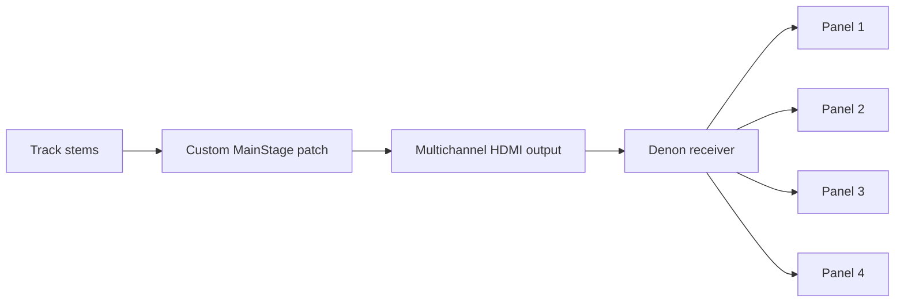

# Audio routing

The original installation used separated musical stems, a custom MainStage patch and a Denon AVR-X2300W receiver. Each instrument stem was assigned to a speaker channel so listeners could move between the parts of a track.

The MainStage screenshot records PA, Close L/R, Far L/R and Main channel strips, together with the patch list and processing sends. It is the retained evidence of the original routing setup.

[Original MainStage screenshot](https://atelierneyra.com/hardware/media/ps_mainstage.jpg) · [Receiver](https://atelierneyra.com/hardware/media/ps_receiver.png)

A reusable audio release can carry the original concert file, stem preparation code, channel map and a cleared example track. These are specific additions to the current documented build rather than assumptions about files present in this repository.
