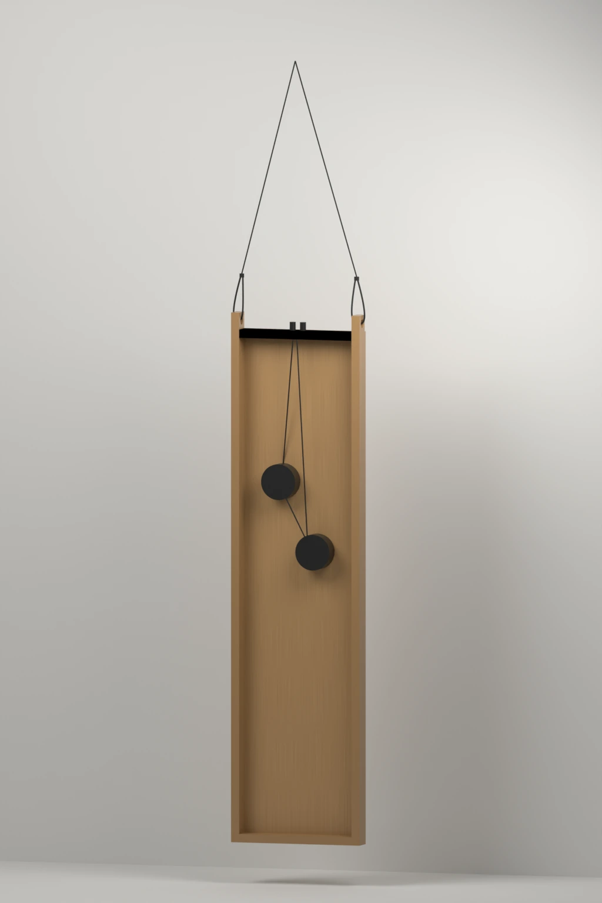

# Original Rhino model

[Download the Rhino model](../hardware/cad/AA-Grad-Show-Speaker.3dm) · [Editable Blender view](../visualisation/native-cad-rear.blend) · [Source provenance](../hardware/cad/provenance.json)

The original model contains the thin radiating face, shallow rear frame, one-ended suspension tabs and hanging and standing studies. Open the `.3dm` in Rhino 8 or a compatible modeller. The document uses millimetres and retains the original layers, groups, saved views and hidden studies.

## Saved dimensions

| Part | Native model dimensions |
| --- | --- |
| Radiating face | 320 × 1220 × 4 mm |
| Rear-frame depth | 40 mm behind the face |
| Suspension | Two wooden tabs at one short end |

These are dimensions of the saved design. Measurements of the achieved panels can be added alongside it.

## CAD and built revisions

The model records an earlier exciter layout. Its simplified driver solids sit higher on the panel than the drivers in the [achieved rear recording](https://atelierneyra.com/hardware/media/ps06.mp4), visible around 17 seconds. Use that recording to understand the built positions and the CAD to continue the saved design.

The original standing study also retains its own support geometry. The centre-back stand in the [current concept pack](concept.md) is a later product refinement.

*Original CAD revision, with illustrated birch and beech materials. Driver shapes and positions follow the saved model.*

## Source and portability

Peter Neyra authored the model. The public copy preserves all 164 objects and their attributes, object IDs and saved mesh geometry. An external rendering environment was removed for portability; the complete original file is retained in the private design archive. The [provenance record](../hardware/cad/provenance.json) identifies both versions and the geometry comparison.

The CAD and authored visualisation are covered by the repository’s MIT licence. Original prototype photographs, music and linked third-party material retain the credits in [CREDITS.md](../CREDITS.md).
